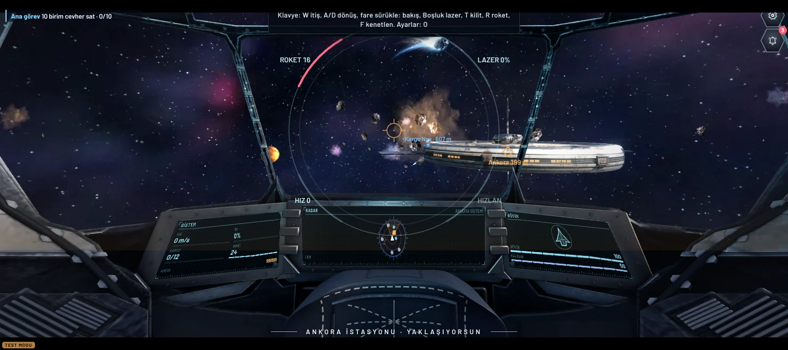
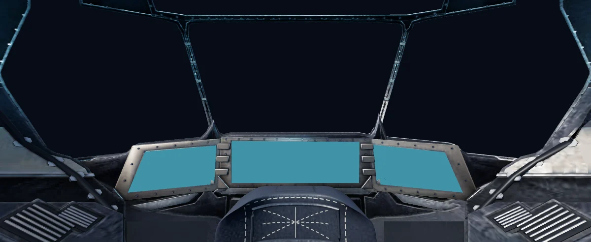
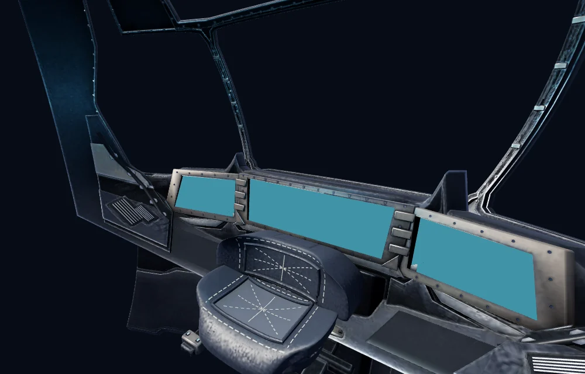
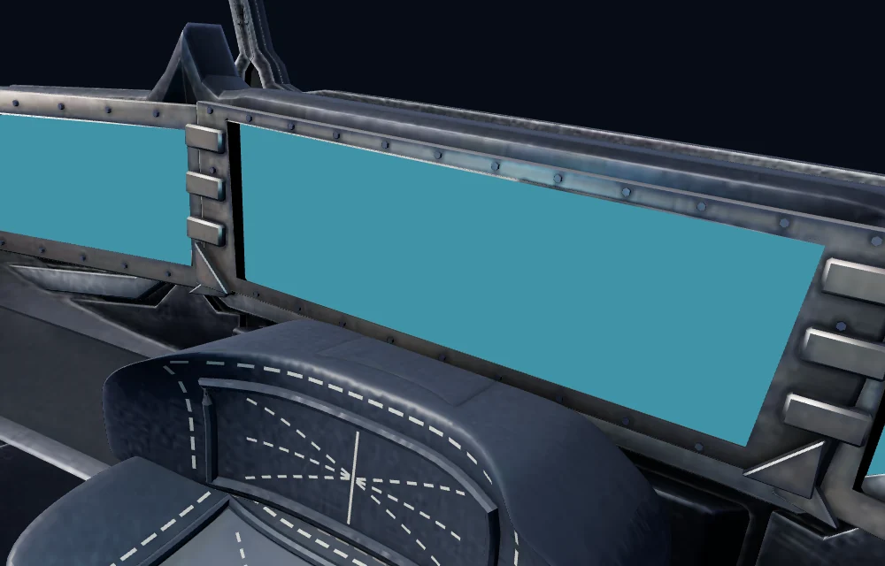
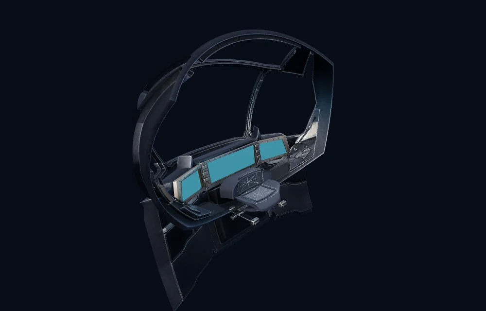
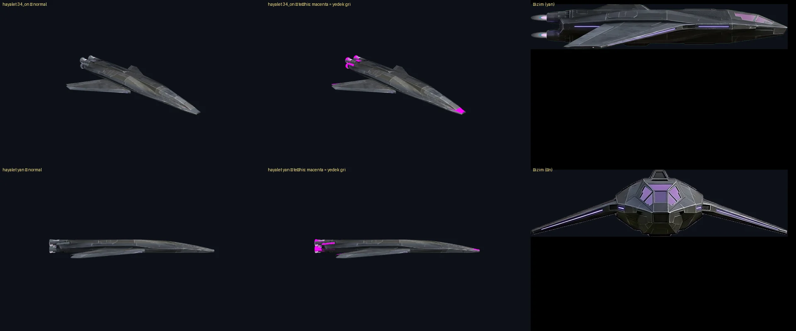
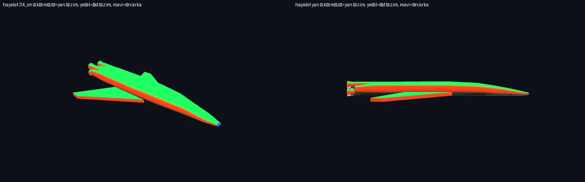

# Aşama 1 — Onaylı Kaşif GLB: teknik referans analizi

Tarih: 2026-11-15 · Yöntem: salt okuma. Kaşif dosyalarına yazılmadı, hiçbir şey yeniden üretilmedi.

## 1. Referans seti (dondurulmuş)

| Rol | Dosya | Konum | Kimlik |
|---|---|---|---|
| **Onaylı görsel** (oyun içi) | `models/cockpit_kasif.glb`, oyunda `?ck=b` ile | dal `claude/bold-bardeen-oqf73o` @ `f5e4733` | ekran görüntüsü: `img/kasif_oyun_ici_glb.webp` |
| **Teknik GLB referansı** | `models/cockpit_kasif.glb` | aynı dal | 3 967 884 bayt · sha256 `9d793c24…f848ba` |
| **Üretim hattı referansı** | `tools/cockpit/` (`build_cockpit.py`, `blender/lib/*`, 1 266 satır Python; `anchors/kasif.json`, `params/kasif.json`) | aynı dal | yalnızca okunur |
| **Entegrasyon referansı** | `tools/cockpit/INTEGRATION_PLAN.md`, `verify/glb_check.*`, `verify/ckb_test.js` | aynı dal | yalnızca okunur |
| Dış model (dondurulmuş) | `buildKasif3D` (`js/game.js:3553`) + `shipart_kasif_*`, `shipx_kasif_*` | main ve dal (piksel düzeyinde aynı) | — |
| Tarihsel (referans **değil**) | `ck_kasif.webp` (main ve dal), paralaks `?ck=q` | — | `STANDARDS.md §0.1` |

## 2. Yapı

| Düğüm | Üçgen | Malzeme | Not |
|---|---|---|---|
| `Cockpit_Body` | 56 374 | 8 primitive: gunmetal 18 878 · dark_steel 12 556 · leather 14 624 · aluminum 5 216 · titanium 3 009 · composite 1 399 · thread 412 · fabric 280 | Tek gövde mesh'i, tek UV atlası. Malzemeler yalnızca metaliklik katsayısıyla ayrışıyor |
| `Detail_strip` ×4 | 4 × 44 | `M_cyan` | emisyon `[0.15, 0.85, 1.0]` × **`KHR_materials_emissive_strength` = 4** |
| `SCR_SYS`, `SCR_RADAR`, `SCR_HULL` | 3 × 2 | `M_screen` | Boş dörtlü yüzeyler, UV 0..1 (TL, TR, BR, BL); oyun canlı ekran dokusunu bunlara bağlar |
| **Toplam** | **56 556** | 10 malzeme | 48 016 köşe (gövde) |

- Koordinat: göz (0, 0, 0); kokpit gözün önünde: X ±1,39 · Y −1,48…1,01 · Z −1,57…−0,37 (metre).
- Kamera sözleşmesi (`anchors/kasif.json`): dikey FOV 74°, asal nokta (800, 239,5) / 1600×656. Three'de `setViewOffset(W, H, 0, H·0,135, W, H)`.
- Dokular: 4 görsel, hepsi **JPEG 2048²**: base 566 KB, ORM 663 KB, normal 127 KB ve **ORM'nin aynısı ikinci kez** 664 KB (piksel farkı 0).
- Doku girdileri: 24 (8 malzeme × 3), yalnızca 4 görsele bağlı.
- Malzemeler `doubleSided: true`. Tangent yok (doğrulayıcı uyarısı). Doğrulayıcı: **0 hata**, 8 uyarı (tangent), 3 bilgi (kullanılmayan nesne).

## 3. Three r128 ölçümleri (oyunun motoru)

| Ölçü | Değer | INTEGRATION_PLAN hedefi | Durum |
|---|---|---|---|
| GLB boyutu | 3,78 MB | ≤ 4 MB | ✓ |
| Gövde üçgeni | 56 374 | ≤ 60 bin | ✓ |
| Draw call | **15** (gövde 8 + şerit 4 + ekran 3) | ≤ 25 | ✓ |
| Yükleme (swiftshader, yerel) | 477 ms | — | bilgi |
| GPU doku nesnesi | **26** (`renderer.info.memory.textures`) | — | ⚠ |
| GPU doku belleği (tahmin) | **~512 MB** (24 doku × 2048² × 4 B × 4/3) | ≤ 40 MB | **⚠ aşıyor** |

**Neden ~512 MB?** Three r128, aynı görüntüyü kullanan her `Texture` nesnesini GPU'ya ayrı yükler. Görüntü paylaşan `Source` sınıfı r138'de geldi. GLB 24 doku girdisi taşıdığı için 4 görsel 24 kez yükleniyor. Bu bir tahmindir; gerçek cihaz ölçümü yapılmadı. Ama `renderer.info.memory.textures = 26` nesne sayısını doğruluyor.
Kaşif'e dokunulmayacak; bu bulgu yalnızca **yeni gemilerin teknik kuralı** olarak kullanılıyor (§5).

Render'lar (dalın kendi doğrulama ışığı; ekranlar düz renk yer tutucu):

  

## 4. Görsel ve kalite standardı (örnek alınacak olan)

- **Malzeme dili:** Fırçalı koyu gunmetal (taban ~0,06–0,08), koyu havacılık çeliği, titanyum ve alüminyum vurgular, kompozit paneller.
  - Koltukta kapitone deri, kumaş yama, kontrast dikiş ipliği.
  - Prosedürel aşınma: kenar aşınması (bevel normali), girinti kiri (AO), çizik, fırça izi, ince kabartma. Hepsi tek atlasa pişirilmiş.
- **Ayrıntı yoğunluğu:**
  - Perçinli ekran çerçeveleri, panjurlu havalandırma ızgaraları, pencere flanşları.
  - Kanopi dikmelerinde ince ışıklı şerit.
  - Hacimli anatomik koltuk: Subsurf minderler, ray ve braketler.
  - Kabuk 5 cm, pah 8 mm.
- **Işık:** Koyu iç mekân; ışığı ekranların camgöbeği yansıması, dış güneş ve patlama ışığı veriyor (oyun tarafı).
- **Doğrulama yaklaşımı:** göz → cam ışın testi (pencere önünde engel yok), ekran köşelerinin izdüşüm hatası ≤ 0,05 px, ekran önü engel testi, Three r128 sayfasında isim, malzeme ve draw call denetimi, Playwright ile oyun içi test ve yedek (fallback).

## 5. Yeni gemiler için teknik kurallar (Kaşif'ten çıkarılan dersler)

| Konu | Kaşif'te | Şahin / Yük Devi / Hayalet'te |
|---|---|---|
| Doku paylaşımı | 8 malzeme × 3 doku girdisi → 24 GPU dokusu | **Tek gövde malzemesi** (`MAT_body`) ve tek doku seti. Metaliklik ORM.B kanalında (fabrikanın kanal bake'i). Hedef GPU ≤ 40 MB |
| Draw call | 15 | Gövde 1, emisyon 1, ekranlar 3 (+ cam 1) → **≤ 6** |
| Emisyon gücü | `emissive_strength = 4`; r128 desteklemiyor → oyunda 1 olarak görünür | Renk ≤ 1, parlaklık bloom'dan (`STANDARDS.md §6`) |
| Doku biçimi | JPEG, ORM iki kez gömülü | WebP, ORM tek kez; ICC profilsiz |
| Yüz yönü | `doubleSided: true` | Tek yüz (kapalı kabuk + gizli yüz silme) |
| Ekran sözleşmesi | `SCR_SYS / SCR_RADAR / SCR_HULL`, UV 0..1 | **Aynı adlar ve UV düzeni korunur** (oyun ekranları ada göre bağlar). Yerleşim ve biçim her gemide özgün |
| Kamera | FOV 74°, göz orijinde | Aynı kamera sözleşmesi (oyun kamerası ortak). Kabuk, cam ve konsol geometrisi gemiye özgü |
| Bütçe | 56,5 bin üçgen, 3,78 MB | Kaşif sınıfında kalır: ≤ 60 bin üçgen, ≤ 4 MB; GPU ≤ 40 MB |

---

# Aşama 1b — Hayalet dış modeli: mor şeritler ve koyu, köşeli kimlik neden kayboluyor?

Yöntem: oyunun kendi `mkShip()` kurucusu, geometri değiştirilmeden render edildi. Teşhis için yalnızca test tarayıcısının **bellekteki** `game.js` kopyasında shader renkleri işaretlendi; diskteki dosyaya dokunulmadı.

| Ölçü (yan / üst görünüş) | Kaşif | Şahin | Yük Devi | Hayalet |
|---|---|---|---|---|
| Yedek gri (`fb`) kaplaması | %0 / %0 | %7 / %7 | %1 / %1 | %2,5 / %3,5 |
| Ortalama parlaklık, render ⟷ çizim | 99,8 ⟷ 100,5 | 91 ⟷ 84 | 63 ⟷ 76 | **71,8 ⟷ 61,2 (+%17)** / **71,5 ⟷ 58,5 (+%22)** |
| Mor piksel oranı, render ⟷ çizim | — | — | — | **%0,01 ⟷ %0,29** (≈ %97 kayıp) |
| Hangi çizim boyuyor (3/4 önden): yan / üst / ön | — | 27 / 63 / 4 | 35 / 44 / 13 | **28 / 67 / 0** |

**Nedenler** (önem sırasıyla):

1. **Projeksiyon ağırlığı.** `buildShip3D` her yüzeyi normaline göre üst ya da yan çizimden boyar (`wy = smoothstep(0.3, 0.8, |n.y|)`). Hayalet çok yassı; görünür yüzeyin %64–67'si **üst çizimle** boyanıyor. Üst çizimde mor şerit yok denecek kadar az (%0,04). Mor şeritler yan çizimde ve yan yüzler ince bir bant.
2. **Ön çizim hiç kullanılmıyor (%0).** Mor kokpit camı ön çizimde (`shipx_hayalet_f`). Ön doku yalnızca `|n.x| > 0,45` olan yüzeylere uygulanıyor; sivri burunda böyle bir yüzey yok.
3. **Emisyon kanalı yok.** Şeritler ışık saçmıyor; renk olarak ışık çarpanıyla çizilip `min(…, 1)` ile kırpılıyor. Gemi küçük göründüğünde 1–3 piksellik çizgiler mipmap ortalamasında koyu gövdeyle karışıp kayboluyor. Bloom bunlara etki etmiyor.
4. **Işık modeli.** Özel shader sahne ışıklarını ve ortam yansımasını kullanmıyor: `l = 0,70 + …`, ×`uGain 1,15`. Koyu ve parlak metal (çizimde köşelerde yansıyan vurgular) %17–22 açılıyor ve mat gümüş-gri görünüyor. Dal 1.46.5 ortam yansıması ekledi ama yalnızca küçük bir fark yaratıyor (piksel farkı ortalaması 0,5–1,5).
5. **Geometri (bilgi için, değiştirilmedi).** Kesitler yumuşak süperelips (`NN` 2,8 → 2,2) ve yumuşak normaller kullanılıyor. Çizimdeki köşeli (stealth) yüzeyler geometride yok, yalnızca dokuda çizgi olarak var.

**Sonuç:** Kayıp temel olarak **çizimden izdüşüm tekniğinin yapısından** kaynaklanıyor (yassı gövdede üst çizim baskın, ön çizim devre dışı, emisyon yok). Yedek gri ikincil. Yeni Hayalet modeli bunu yapısal olarak çözecek:

- Köşeli yüzeyler gerçek geometride olacak.
- Mor şeritler ayrı emisyon (gövde emisyon atlası ve/veya `MAT_emit`) olacak.
- Koyu, parlak metal PBR ile ortam yansıması alacak.
- Kokpit camı ayrı malzeme olacak.

Mevcut oyundaki modele malzeme düzeyinde geçici bir iyileştirme de mümkün (ön doku eşiği, emisyon maskesi, kazanç). Ama bu ana oyun koduna dokunur; ancak ayrı onayla ve ana sohbette yapılır.
