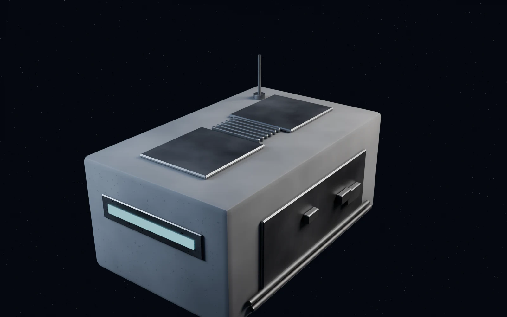
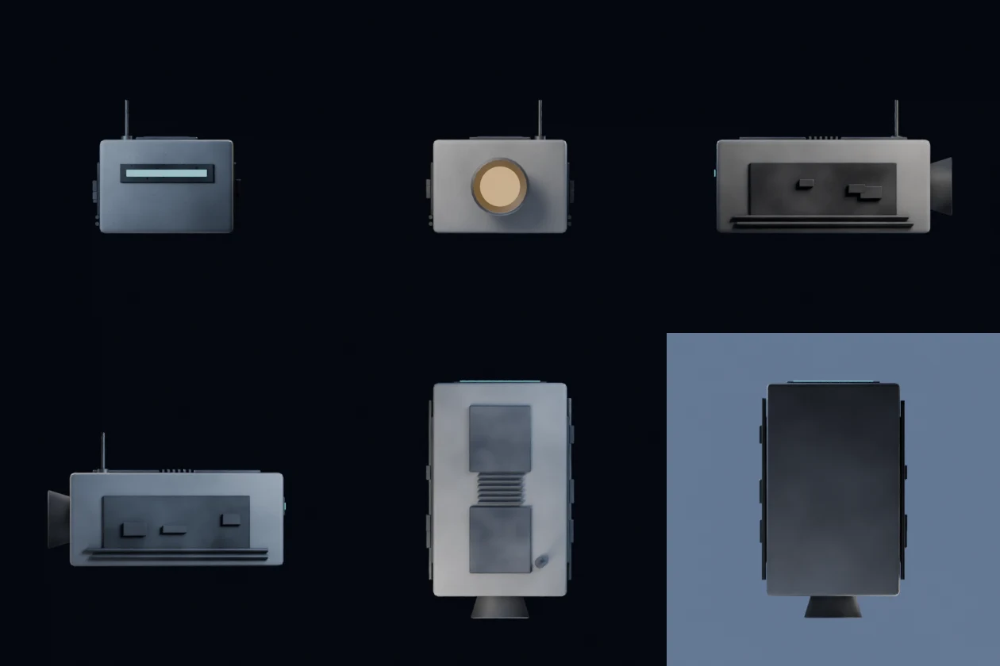
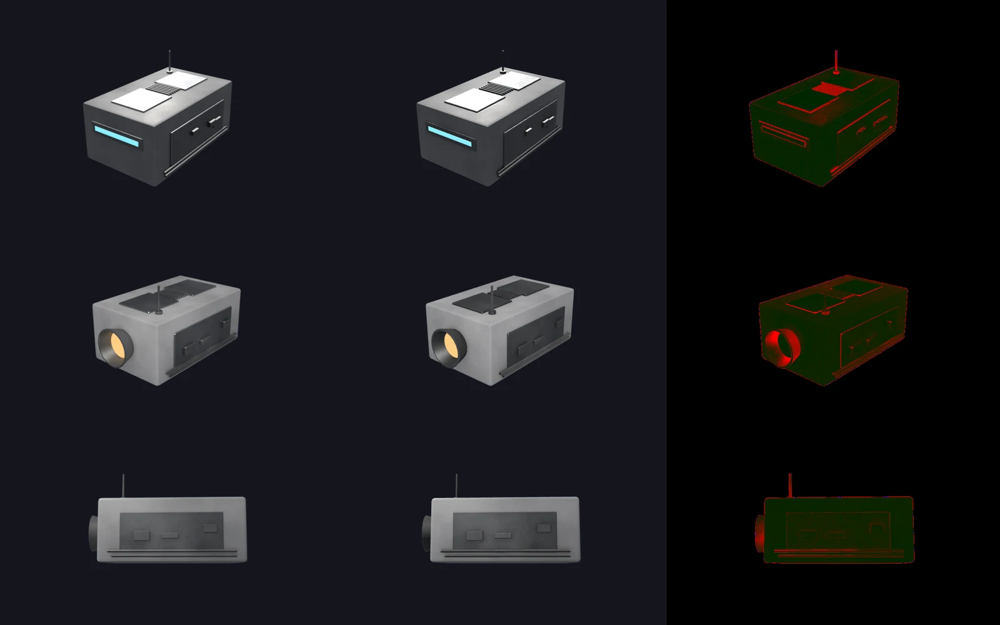
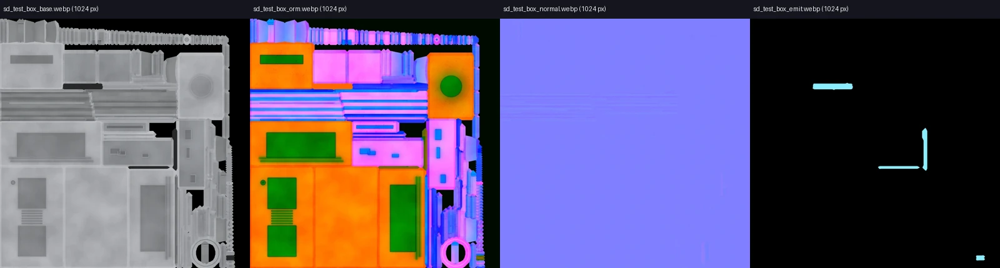

# Aşama 2 — Faz 0 test kutusu: teslim paketi raporu

Teslim paketi: `deliveries/test_box/r002/` · Durum: **QC WARN: 65 PASS, 2 WARN, 0 FAIL, 2 SKIP**.
Test kutusu yalnızca hattı doğrulayan bir nesnedir; oyun varlığı değildir ve oyuna girmez.

> **Revizyon notu (r001 → r002).** Bu raporu hazırlarken r001'de QC'nin kaçırdığı bir hata buldum: **soket yönleri yanlıştı.** Motor soketi geriye (+Z) değil aşağıya (−Y) bakıyordu.
> - Neden: glTF dışa aktarıcısı düğümün yerel eksenlerini de Y-up'a çeviriyor; glTF yerel −Z, Blender'daki yerel +Y'ye karşılık geliyor.
> - Düzeltme: `core/export.py`.
> - Önlem: QC'ye `contract.socket_dir` testi eklendi. Three r128'de okunan yön ile tarifteki yön arasındaki açı en fazla 1° olabilir.
> - Sonuç: r002 aynı geometriyle (hash `4f5b25b3…`, r001 ile eşit) yeniden üretildi ve iki soket de testi geçti.

## 1. Blender render (lookdev, Cycles)

## 2. Three.js render ve ΔE karşılaştırması

Her satırda soldan sağa:
- **Sol:** Blender (Cycles), nötr ışık, altın referans.
- **Orta:** Three r128 (oyunun `vendor/three.min.js` dosyası), aynı kamera ve eşdeğer ışık.
- **Sağ:** ΔE haritası (kırmızı = renk farkı, mavi = siluet farkı).

| Kamera | Parlaklık farkı | ΔE ortalama | ΔE p95 | Siluet farkı | Eşik (FAIL) |
|---|---|---|---|---|---|
| Ön 3/4 | %4,2 | 2,33 | 11,1 | %0,24 | %8 / 6,0 / — / %1 |
| Arka 3/4 | %2,3 | 2,69 | 11,3 | %0,22 | |
| Yan | %1,7 | 1,90 | 7,0 | %0,17 | |

ΔE ortalaması 2–3, yani gözle zor ayrılan düzeyde. p95'in 7–11 olması şu bölgelerden geliyor:

- Kenar pikselleri (kenar yumuşatma).
- 1 cm altı ızgara ve anten ayrıntıları (doku çözünürlüğü sınırı).
- Motor çanının içi: Cycles çanın içindeki çoklu yansımayı hesaplıyor, Three'de dolaylı ışık yok.

Düz yüzeylerde fark neredeyse sıfır.
Işık eşdeğerliği deneyle kalibre edildi: düz renkli float ortam ışığı ve `DirectionalLight = güneş gücü / π`. Cycles nötr düzeninde güneş gölgesi kapalı (oyunda gerçek zamanlı gölge yok varsayımı, GEÇİCİ).

## 3. GLB ve dokular

| Dosya | Boyut |
|---|---|
| `sd_test_box_r002.glb` (dokular gömülü, `EXT_texture_webp`) | **272 KB** (Blender çıkışı 361 KB; doku yeniden kodlamasıyla −%25) |
| `textures/sd_test_box_base.webp` (1024², q88) | 37 KB |
| `textures/sd_test_box_orm.webp` (1024², q92; R = AO, G = pürüzlülük, B = metaliklik) | 99 KB |
| `textures/sd_test_box_normal.webp` (1024², q92, tangent, +Y) | 11 KB |
| `textures/sd_test_box_emit.webp` (1024², sabit ön şerit) | 4 KB |

## 4. Üçgen, draw call ve bellek

| Ölçü | Değer | Bütçe ("test" sınıfı = oyuncu gemisi satırı) |
|---|---|---|
| Üçgen LOD0 / LOD1 / LOD2 | **1 177 / 540 / 195** (kaynak 1 306; gizli yüz silmeyle −129) | 12 000 / 5 000 / 1 500 |
| Draw call (LOD0, Three ölçümü) | **2** (`MAT_body` + `MAT_emit`) | ≤ 3 |
| Malzeme | 2 | ≤ 3 |
| GPU doku belleği (tahmin) | 21,3 MB (4 × 1024², mipmap dahil) | — (bkz. not) |
| Texel yoğunluğu | 259 px/m medyan (p05 248, p95 261) | 256 ± %30 |
| UV doluluk | %59 | — |

Not: 1,8 m'lik bir test kutusu için 21 MB fazla. Emisyon dokusu neredeyse boş (4 KB dosya) ama GPU'da 5,3 MB yer kaplıyor. Gerçek varlıklarda sabit emisyonun ayrı doku yerine başka yollarla taşınması değerlendirilecek: base'in alfa kanalı, vertex color ya da `MAT_emit`.

## 5. Performans (Playwright, swiftshader; yalnızca göreli)

| Profil | n=1 | n=12 | n=40 |
|---|---|---|---|
| Masaüstü 1200×750 | 10,0 ms | 44,7 ms | 110,7 ms |
| iPad Pro 11 (yatay) | 11,0 | 44,8 | 117,2 |
| iPhone 13 (yatay) | 12,3 | 46,9 | 110,0 |
| Pixel 7 (yatay) | 10,5 | 50,1 | 111,4 |

Bu ölçümler yazılım GPU'sunda alındı; mutlak hız değil. Gerçek cihaz ölçümü `qc/viewer/bench.html` ile yapılacak.

**r002 bulgusu:** Aynı geometride n=1 ölçümü r001'e göre %32 yavaş çıktı ve yanlışlıkla FAIL verdi. n=1'de ölçülen, varlığın maliyeti değil kare başına sabit giderlerdir. Kural düzeltildi: gerileme kararı yalnızca n ≥ 12'de veriliyor, n=1 bilgi amaçlı.

## 6. QC raporu

Tam rapor: `deliveries/test_box/r002/qc_report.html` (ve `.json`).

| Katman | Test sayısı | Sonuç |
|---|---|---|
| L2 statik (glTF Validator, sözleşme, geometri, UV, PBR, bütçe, tekrar üretilebilirlik) | 49 | 47 PASS, 2 WARN |
| L3 motor sadakati (yükleme, malzeme, draw call, soket yönü, yüz yönü, LOD silueti, Blender ⟷ Three) | 11 | 11 PASS |
| L4 performans | 12 + 1 | 12 PASS, 1 SKIP (gerçek cihaz) |
| Referans siluet | 1 | SKIP (test nesnesinin referans çizimi yok) |

Öz-test (r002 GLB'si üzerinde): bilerek bozulan 4 dosyanın 4'ü de yakalandı (ters yüzler, yasak emisyon uzantısı, yanlış adlar, fazla malzeme).
Bu, QC'nin bu dört hata türünü yakaladığını gösterir. **Gerçek oyun varlıklarının bütün teknik kontrolleri geçeceği anlamına gelmez.** Soket hatası da tam olarak böyle bir boşluktu.

## 7. İki WARN'ın açıklaması

1. **`pbr.base_metal` = [116, 159], sınır [120, 250].** Metal yüzeylerin %5'i PBR alt sınırının biraz altında. Neden: prosedürel malzemede "kir" metal taban rengini çarpanla koyulaştırıyor. Fiziksel olarak kir metal değildir; kir olan yerde metalik değer düşmeli, pürüzlülük artmalı. Gerçek varlıklardan önce düzeltilecek: kir katmanı dielektrik olarak modellenecek.
2. **`gltf.validator_warnings` = 3 (`MESH_PRIMITIVE_GENERATED_TANGENT_SPACE`).** GLB'de tangent yok; Three normal haritası için tangentleri çalışma anında üretiyor. Kaşif GLB'sinde de aynı uyarı var (8 kez). Etkisi ölçüldü: ΔE ortalaması 1,9–2,7. Tangent eklemek köşe başına 16 bayt getirir. Karar: tangentsiz devam ediliyor, gerçek varlıklarda ΔE izlenecek.

## 8. Üretim aşamalarının süreleri (r002, tam kalite)

| Aşama | Süre | Ayrıntı |
|---|---|---|
| Model + lookdev render | 297,8 s | Kurulum 0,2 s · lookdev render ~250 s (3 görüntü, 96 örnek) · dik görünüşler ~20 s · altın referans ~26 s |
| Hazırlık (oyuna hazırlık) | 176,7 s | UV ~40 s · bake ~131 s (2048 değil 1024²; AO 128 örnek) · dışa aktarma ve doku <2 s |
| QC | 43,5 s | Validator 0,1 s · Blender testleri 0,9 s · tekrar üretim 0,8 s · Three r128 + 4 cihaz performansı 41,8 s |
| **Toplam** | **~518 s (8,6 dk)** | Hızlı mod (`--fast`) ~2 dk |

En pahalı adımlar lookdev render ve bake. Gerçek gemilerde süre yükselecek; PREVIEW profili hızlı modda çalışacak.
